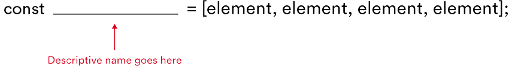
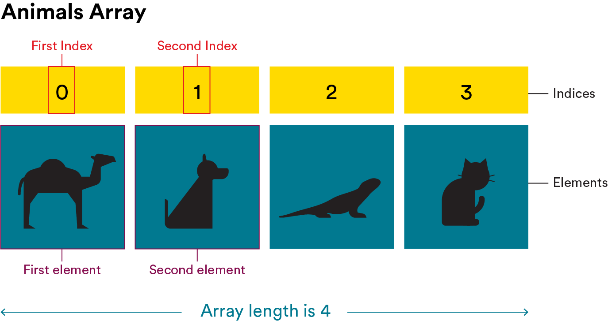
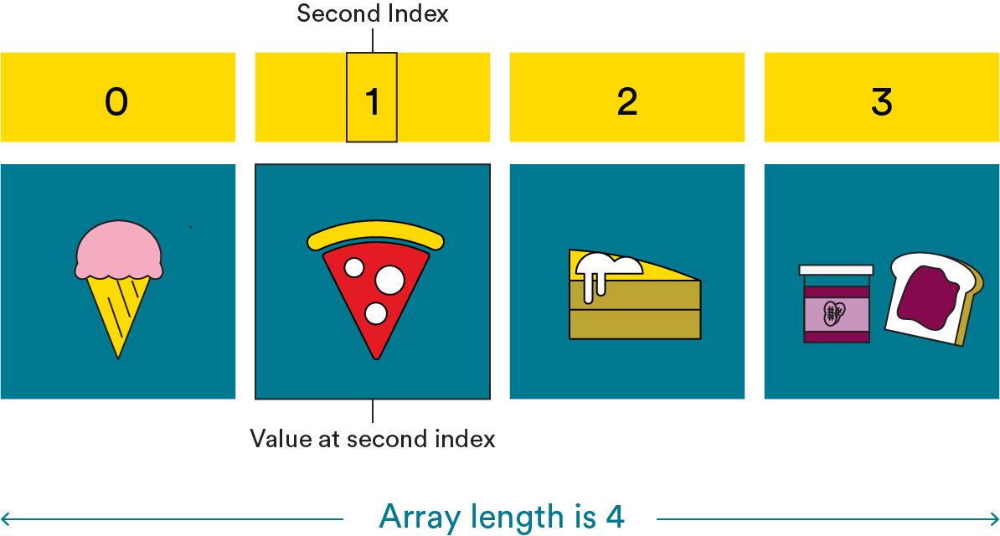
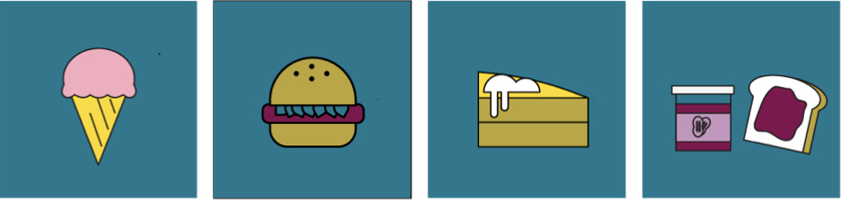

<textarea id="source">

<h1 class="slide-header">Arrays and Objects</h1>

<span id=time-estimate class="color-grey-500">30 mins</span>

<p id="lesson-description">
Imagine you’re creating a list of your favorite songs. Instead of writing each song on a separate note, it would be much easier to keep them all together in one place.

Similarly, in JavaScript, it wouldn’t be efficient to store each song title in a separate variable. Instead, we can use <strong>arrays</strong> and <strong>objects</strong>, which allow us to store multiple pieces of related data in a single variable.

These powerful tools help organize and manage data more effectively. Let’s explore how they work!

</p>

<h5 id="topics-header" class="color-grey-500">Topics</h5>

Arrays

<hr>

Array Methods and Properties

<hr>

Objects

<hr>

<a href="./assets/arrays_and_objects_study_guide.pdf" target="_blank" download="arrays_and_objects_study_guide.pdf" class="ant-btn" data-trackable="true" data-track-category="study guide" data-track-section="lesson page" data-track-action="download study guide"><span role="img" class="anticon"><svg viewBox="0 0 16 16" width="1em" height="1em" fill="currentColor" aria-hidden="true" focusable="false" class=""><g class="download_svg__nc-icon-wrapper"><path d="M8 12c.3 0 .5-.1.7-.3L14.4 6 13 4.6l-4 4V0H7v8.6l-4-4L1.6 6l5.7 5.7c.2.2.4.3.7.3z"></path><path data-color="color-2" d="M1 14h14v2H1z"></path></g></svg></span><span> Download Study Guide</span></a>

---

<h1 class="slide-header">Learning Objectives</h1>

<p>By the end of this lesson, you'll be able to:</p>

<ul>
  <li>Build arrays and objects in JavaScript.</li>
  <li>Explore and manipulate arrays using properties and methods.</li>
  <li>Use dot notation to access or change information in an object.</li>
</ul>

---

<h1 class="slide-header">So Much Cheese, So Little Time</h1>


Your friend is passionate about cheese and wants to keep track of all the different types they have tried. So far, they have sampled 750 varieties from around the world and want to create a JavaScript program to catalog them along with tasting notes.

But if they store each type of cheese in a separate variable, it would require a lot of repetitive work, like this:

```javascript
const cheese1 = "Aged Cheddar";
const cheese2 = "Brie";
const cheese3 = "Gouda";
const cheese4 = "Paneer";
...
```

If only there were a way for a **single variable** to store multiple values...

That's where the **array** comes in! An array allows us to store multiple related items in a single variable, making it much easier to manage and organize data.

---

<h1 class="slide-header">Introduction to Arrays</h1>
<!--
  WISTIA EXAMPLE. REPLACE 11dit621rx with the id
-->
<div class="wistia_embed wistia_async_63qm6h7hlg wistia_embed_initialized" id="wistia-63qm6h7hlg"
  style="width: 100%; height: 90%;">
  <div id="wistia_chrome_23" class="w-chrome notranslate" tabindex="-1">
    <div id="wistia_grid_57_wrapper" style="display: block; width: 630px; height: 354.375px;">
      <div id="wistia_grid_57_above" style="height: 0px; font-size: 0px; line-height: 0px;"> </div>
      <div id="wistia_grid_57_main" style="width: 630px; left: 0px; height: 354.375px; margin-top: 0px;">
        <div id="wistia_grid_57_center" style="width: 100%; height: 100%;">
          <div class="w-video-wrapper w-css-reset"
            style="height: 100%; position: absolute; top: 0px; width: 100%; opacity: 1;">
            <video id="wistia_simple_video_135" crossorigin="anonymous"
              poster="https://fast.wistia.com/assets/images/blank.gif" aria-label="Video" controlslist="nodownload"
              playsinline="" preload="auto" type="video/m3u8" x-webkit-airplay="allow"
              style="background: transparent; display: block; height: 100%; max-height: none; max-width: none; position: static; visibility: visible; width: 100%; object-fit: contain;"></video>
          </div>
          <div class="w-ui-container"
            style="height: 100%; left: 0px; position: absolute; top: 0px; width: 100%; opacity: 1;">
            <div class="w-vulcan-v2 w-css-reset" id="w-vulcan-v2-56"
              style="border-radius: 0px; box-sizing: border-box; cursor: default; direction: ltr; height: 100%; left: 0px; position: absolute; visibility: visible; top: 0px; width: 100%;">
              <div class="w-vulcan--background w-css-reset"
                style="height: 100%; left: 0px; position: absolute; top: 0px; width: 100%;">
                <div class="w-css-reset" data-handle="statusBar"></div>
                <div class="w-css-reset" data-handle="backgroundFocus"><button
                    aria-label="Play Video: A Brief History of the Web" class="w-css-reset w-vulcan-v2-button"
                    tabindex="0" style="width: 0px; height: 0px; pointer-events: none;"></button></div>
              </div>
              <div aria-live="polite" class="w-vulcan--aria-live w-css-reset" aria-atomic="true"
                style="position: absolute; left: -99999em;"></div>
              <div class="w-vulcan-overlays-table w-css-reset"
                style="display: table; pointer-events: none; position: absolute; width: 100%;">
                <div class="w-vulcan-overlays--left w-css-reset"
                  style="display: table-cell; vertical-align: top; position: relative; width: 0px;">
                  <div class="w-css-reset" style="height: 321.375px;"></div>
                </div>
                <div class="w-vulcan-overlays--center w-css-reset"
                  style="display: table-cell; vertical-align: top; position: relative; width: 100%;">
                  <div class="w-css-reset" style="height: 321.375px;">
                    <div class="w-css-reset" data-handle="bigPlayButton" style="pointer-events: auto;">
                      <div class="w-bpb-wrapper w-css-reset w-css-reset-tree"
                        style="border-radius: 0px; display: none; left: calc(50%); margin-left: -61.5234px; margin-top: -39.375px; overflow: hidden; position: absolute; top: calc(50% + 0px);">
                        <button class="w-big-play-button w-css-reset-button-important w-vulcan-v2-button" tabindex="0"
                          type="button" style="cursor: pointer; height: 78.75px; box-shadow: none; width: 123.047px;">
                          <div
                            style="background: rgb(1, 121, 145); display: block; left: 0px; height: 78.75px; mix-blend-mode: darken; position: absolute; top: 0px; width: 123.047px;">
                          </div>
                          <div
                            style="background-color: rgba(1, 121, 145, 0.7); height: 78.75px; left: 0px; position: absolute; top: 0px; transition: background-color 150ms ease 0s; width: 123.047px;">
                          </div><svg x="0px" y="0px" viewBox="0 0 125 80" enable-background="new 0 0 125 80"
                            aria-hidden="true" alt=""
                            style="fill: rgb(255, 255, 255); height: 78.75px; left: 0px; stroke-width: 0px; top: 0px; width: 100%; position: absolute;">
                            <rect fill-rule="evenodd" clip-rule="evenodd" fill="none" width="125" height="80"></rect>
                            <polygon fill-rule="evenodd" clip-rule="evenodd" fill="#FFFFFF" points="53,22 53,58 79,40">
                            </polygon>
                          </svg>
                        </button>
                      </div>
                    </div>
                    <div class="w-css-reset" data-handle="clickForSoundButton" style="pointer-events: auto;">
  <div class="w-css-reset w-css-reset-tree" data-handle="click-for-sound-backdrop"
    style="display: none; height: 100%; left: 0px; pointer-events: auto; position: absolute; top: 0px; width: 100%;">
    <button aria-label="Click for sound" class="w-vulcan-v2-button click-for-sound-btn"
      style="background: rgba(0, 0, 0, 0.8); border: 2px solid transparent; border-radius: 60px; cursor: pointer; display: flex; justify-content: space-between; align-items: center; outline: none; pointer-events: auto; position: absolute; right: 20.1484px; top: 20.1484px; max-width: 589.703px;">
      <div
        style="display: flex; align-items: center; justify-content: flex-end; white-space: nowrap; overflow: hidden; max-width: 0px; transition: max-width 200ms ease 0s;">
        <span
          style="color: rgb(255, 255, 255); font-family: WistiaPlayerInter, Helvetica, sans-serif; font-size: 15px; font-weight: 500; padding-left: 1em; white-space: nowrap; overflow: hidden; text-overflow: ellipsis; max-width: 630px;">Click
          for sound</span>
      </div><svg viewBox="0 0 237 237" width="51.6796875" height="51.6796875"></svg>
    </button>
</div>
</div>
</div>
                </div>
              </div>
            </div>
          </div>
        </div>
      </div>
    </div>
  </div>
</div>
<!-- YOUTUBE -->
<!-- VIMEO -->

<details>
<summary>Transcript</summary>
  
<p class="transcript-text">
  We’ve learned how variables are used to temporarily store and remember data. But say we’re dealing with multiple variables. Then what do we do?

For instance, say we’re creating a grocery list of items we need for a fruit salad. We could declare each of the items individually. This would kind of be like writing each item on our list on a different sheet of paper. It would probably be easier and make more sense to just have it all in one place.

We can do the same thing with variables using arrays. An array is a list of values contained within brackets and separated by commas. Each value in the array is called an element. Just as we might refer to an item on a grocery list by its placement, the same is true for the elements in an array. However, instead of starting at one, we start at zero.

We’ll get into all of this in depth later on. For now, just remember that when we’re dealing with the variable salad, arrays can help us keep all of our ingredients in one place.

</p>
</details>

---

<h1 class="slide-header">Array Syntax</h1>



An **array** is a way to organize multiple pieces of information in JavaScript. Instead of storing each value in a separate variable, an array allows us to store **a list of values** inside a single variable.

The individual items in an array are called **elements**. These elements are **separated by commas** and enclosed within **square brackets `[ ]`**.

```js
const beverages = ['coffee', 'tea', 'hot chocolate', 'milk'];
const leapYears = [2016, 2020, 2024, 2028];
```

- Arrays usually store one type of data (all numbers or all strings).
- Arrays in JavaScript are flexible—they can grow or shrink in size as needed.

Arrays help keep information organized and make it easier to work with multiple values at once!

---

<h1 class="slide-header">Indices</h1>

Items in an array are stored in a **specific order**. Each item has a unique **index**, which is a number that tells us the position of the item in the array.

These **index numbers** allow us to access or update individual values within an array.

Take a look at this grocery list. Notice how each item is assigned a number:

```html
1. Milk 2. Cheese 3. Juice 4. Cauliflower
```

Arrays in JavaScript work in a similar way, but there's one key difference: **JavaScript starts counting from 0 instead of 1!** We’ll explore how this works next.

---

<h1 class="slide-header">Index Values</h1>

You may have noticed that the numbering starts at **`0` instead of `1`**. This is because JavaScript, like many programming languages, uses **zero-based indexing**.

This means the **first** item in an array has an index of `0`, the **second** item has an index of `1`, and so on.

```javascript
const animals = ['camel', 'dog', 'lizard', 'cat'];
```

This array contains **four elements**, but their positions (indices) start from `0`.



---

<h1 class="slide-header">Knowledge Check</h1>

Look at the array below. Can you determine the **index** of `"spaghetti"`?

```js
const favoriteFoods = [
  'rice and curry',
  'spaghetti',
  'mango pudding',
  'hummus',
];
```

Remember, **JavaScript starts counting from `0`**.

<fieldset>
  <legend>Please select one of the following:</legend>
  <input type="radio" name="action" id="track" value="track" /><label for="track">0</label><br />
  <input type="radio" name="action" id="event" value="event"  correct="true" /><label for="event">1</label><br />
  <input type="radio" name="action" id="message" value="message" /><label for="message">2</label><br />
  <input type="radio" name="action" id="answer4" value="answer4" /><label for="answer4">3</label><br />

</fieldset>
<button class="ant-btn ant-btn-primary multiple-choice-radio-submit">Submit Answer</button>

---

<h1 class="slide-header">Accessing Elements of an Array</h1>

To retrieve a specific item from an array, we use **bracket notation**. This means writing the array’s name followed by square brackets `[ ]`, with the index of the item inside.

For example, `arrayName[0]` tells JavaScript:

1. Look at the array called `arrayName`.
2. Get the value at index `0` (the first item).

Let’s try this with our **favoriteFoods** array. Below, we use `console.log()` to access the **second item** in the list:

```js
const favoriteFoods = ['ice cream', 'pizza', 'lemon cake', 'almond butter'];

console.log(favoriteFoods[1]); // What do you think this will print?
```

_If you said "pizza" you are correct!_



---

<h1 class="slide-header">Updating Elements of an Array</h1>

Just like variables, array elements can be updated. To change a value in an array:

1. Use the **array name**.
2. Add **square brackets `[ ]`** with the **index** of the item you want to update.
3. Use the **assignment operator `=`** to set a new value.

```js
favoriteFoods[1] = 'veggie burger';
```

In this case, we are replacing `"pizza"`, which was previously at index `1`, with `"veggie burger"`.

Now, the updated array looks like this:

```js
['ice cream', 'veggie burger', 'lemon cake', 'almond butter'];
```



- **Arrays are mutable**, meaning we can change their contents.
- **Index numbers must be used correctly**, or the wrong item will be updated.
- **Only the selected value changes**—the rest of the array stays the same.

---

<h1 class="slide-header">Knowledge Check</h1>

Look at the code snippet below. Can you figure out what the **console** will display?

```js
const luckyNumbers = [13, 42, 7, 28];
luckyNumbers[0] = 99;
luckyNumbers[2] = luckyNumbers[0] - luckyNumbers[2];
console.log(luckyNumbers);
```

<fieldset>
  <legend>Please select one of the following</legend>
  <input type="radio" name="action" id="track" value="track" /><label for="track">[99, 71, 7, 8]</label><br />
  <input type="radio" name="action" id="event" value="event"  correct="true" /><label for="event">[99, 42, 92, 28]</label><br />
  <input type="radio" name="action" id="message" value="message" /><label for="message">[13, 15, 7, 28]</label><br />
</fieldset>
<button class="ant-btn ant-btn-primary multiple-choice-radio-submit">Submit Answer</button>

---

<h1 class="slide-header">The Length Property</h1>

Arrays don’t just store multiple values—they also come with **built-in properties and functions** that make them even more useful.

One important property is **`length`**, which tells us how many elements are in an array. To find the length of an array, simply add `.length` to the array’s name.

```js
const numbers = [10, 20, 30, 40];
console.log(numbers.length); // Outputs: 4
```

- `.length` returns the total number of elements in an array.
- The count starts at **1**, even though JavaScript indexing starts at `0`.
- This property is useful when checking if an array has data in it.

---

<h1 class="slide-header">Push and Pop</h1>

Just like we can modify **strings** using concatenation, we can modify **arrays** using **array methods**. Methods are built-in functions that allow us to **add, remove, or rearrange** elements in an array.

Let’s start with two basic but useful methods:

| Method    | What It Does                                       | How It’s Used              |
| --------- | -------------------------------------------------- | -------------------------- |
| `push`    | **Adds** a new item to the **end** of an array.    | `arrayName.push(newItem);` |
| `pop`     | **Removes** the **last** item from an array.       | `arrayName.pop();`         |

```js
const fruits = ['apple', 'banana', 'mango'];

// Adding a new item
fruits.push('orange');
console.log(fruits); // ["apple", "banana", "mango", "orange"]

// Removing the last item
fruits.pop();
console.log(fruits); // ["apple", "banana", "mango"]
```

(And yes, there are **many more array methods**, but we’ll start with these basics!)

---

<h1 class="slide-header">Knowledge Check</h1>

We’ve learned that:

- `.push()` **adds** a new item to the **end** of an array.
- `.pop()` **removes** the **last** item from an array.

Now, look at the code below. Can you predict what will be printed in the **console**?

```js
const favoriteSports = ['football', 'basketball', 'tennis'];
favoriteSports.pop();
favoriteSports.push('cricket');
console.log(favoriteSports);
```

<fieldset>
  <legend>Please select one of the following</legend>
  <input type="radio" name="action" id="track" value="track" /><label for="track">["football", "basketball", "tennis", "cricket"]</label><br />
  <input type="radio" name="action" id="event" value="event"  /><label for="event">["cricket", "football", "basketball"]</label><br />
  <input type="radio" name="action" id="message" value="message" correct="true"  /><label for="message">["football", "basketball", "cricket"]</label><br />
  <input type="radio" name="action" id="answer4" value="answer4" /><label for="answer4">["tennis", "football", "basketball", "cricket"]</label><br />
</fieldset>

<button class="ant-btn ant-btn-primary multiple-choice-radio-submit">Submit Answer</button>

---

<h1 class="slide-header">Your Turn</h1>

Now it's time to put your array skills to the test! Follow these steps to create and modify an array:

1. **Create an array** called `favoriteFoods` and add **four food items** of your choice.
2. **Add two more items** to the array using `.push()`.
3. **Remove the last item** from the array using `.pop()`.
4. **Print the updated array** using `console.log()`.
5. **Check the array length** by logging `favoriteFoods.length`.

<iframe sandbox="allow-scripts allow-top-navigation allow-top-navigation-by-user-activation allow-forms allow-popups allow-same-origin"  height="400" style="width: 100%;" scrolling="no" title="Favorite Foods" src="https://codepen.io/GAmarketing/embed/poBNxqv?default-tab=js%2Cresult&editable=true" frameborder="no" loading="lazy" allowtransparency="true" allowfullscreen="true">
  See the Pen <a href="https://codepen.io/GAmarketing/pen/poBNxqv">
  Favorite Foods</a> by General Assembly (<a href="https://codepen.io/GAmarketing">@GAmarketing</a>)
  on <a href="https://codepen.io">CodePen</a>.
</iframe>

---

<h1 class="slide-header">Our Next Data Structure - Objects</h1>

Arrays are great for storing **lists of similar items**, like your favorite foods or hobbies.

But what if you wanted to store **different types of information**—such as your name, age, hometown, and hobbies—all in one place? An array wouldn’t work well for that, but **an object can!**

**What is an Object?**

An **object** is a data structure that stores multiple pieces of related information using **key-value pairs**. Each **key** represents a category (like "name" or "age"), and each **value** holds the actual data.

Here’s an example of how we write an object:

```js
const aboutMe = {
  name: 'Aisha',
  hometown: 'London, UK',
  age: 25,
  isStudent: false,
  hobbies: ['reading', 'traveling', 'playing football'],
};
```

Key Features of Objects:

- **Curly braces `{ }`** enclose all the data.
- Each **property** (like `"name"`, `"age"`, or `"hobbies"`) has a **value**.
- Values can be **strings, numbers, booleans, or even arrays**.

---

<h1 class="slide-header">Key Value Pairs</h1>

Objects store data in **key-value pairs**, grouping related information under one name. In the example below, our object is called `aboutMe`, and it contains _five_ key-value pairs.

**What is a Key-Value Pair?**

Think of a **key** as a **label** and a **value** as the **information** connected to it.  
For example:

- The **key** `"name"` is like a question: _"What is your name?"_
- The **value** `"Aisha"` is the answer: _"Aisha."_

Keys and values are **separated by a colon (`:`)**, and each pair is **separated by a comma**.

```js
const aboutMe = {
  name: 'Aisha',
  hometown: 'London, UK',
  age: 25,
  isStudent: false,
  hobbies: ['reading', 'traveling', 'playing football'],
};
```

**Why Are Objects Useful?**

Objects are useful because they can store different types of data, such as **strings**, **numbers**, **Booleans**, and even **arrays**, all in one place. They help organize related information, making it easier to manage and access. Objects can also store other objects as properties, allowing for more complex and structured data storage.

---

<h1 class="slide-header">Knowledge Check</h1>

Which of the following statements about the syntax of this object are **true**?

```js
const aboutMe = {
  name: 'Aisha',
  hometown: 'London, UK',
  age: 25,
  isStudent: false,
  hobbies: ['reading', 'traveling', 'playing football'],
};
```

<fieldset>
  <legend>Please select all that are correct:</legend>
  <input type="checkbox" id="uniqueAnswer" name="unique" /><label for="uniqueAnswer">age is a value</label><br />
  <input type="checkbox" id="uniqueAnswer2" name="unique2" correct="true"/><label for="uniqueAnswer2">isStudent is a key</label><br />
  <input type="checkbox" id="uniqueAnswer3" name="unique3" correct="true"/><label for="uniqueAnswer3">25 is a value</label><br />
  <input type="checkbox" id="uniqueAnswer4" name="unique4" /><label for="uniqueAnswer4">true is a key</label><br />
  <input type="checkbox" id="uniqueAnswer5" name="unique5" correct="true"/><label for="uniqueAnswer5">hobbies is a key</label><br />
  <input type="checkbox" id="uniqueAnswer6" name="unique6" /><label for="uniqueAnswer6">"London, UK" is a key</label><br />
</fieldset>

<button class="ant-btn ant-btn-primary multiple-choice-checkbox-submit">Submit Answer</button>

---

<h1 class="slide-header">All About You</h1>

Now, it’s your turn to share something about yourself using an **object**!

1. **Create an object** named `aboutMe`.
2. **Add four key-value pairs** inside the object.
3. **Include these required properties**:
   - Your **name** as a key with a string as the value.
   - Your **age** as a key with a number as the value.
   - At least **one property that contains an array** (your hobbies or favorite foods).
4. **Use `console.log()`** to display your object and check your work.

<iframe sandbox="allow-scripts allow-top-navigation allow-top-navigation-by-user-activation allow-forms allow-popups allow-same-origin"  height="400" style="width: 100%;" scrolling="no" title="All About You" src="https://codepen.io/GAmarketing/embed/rNbWqoL?default-tab=js%2Cresult&editable=true" frameborder="no" loading="lazy" allowtransparency="true" allowfullscreen="true">
  See the Pen <a href="https://codepen.io/GAmarketing/pen/rNbWqoL">
  All About You</a> by General Assembly (<a href="https://codepen.io/GAmarketing">@GAmarketing</a>)
  on <a href="https://codepen.io">CodePen</a>.
</iframe>

---

<h1 class="slide-header">Accessing Values from an Object with Dot Notation</h1>

Just like we use **bracket notation** to access items in an array, we can use **dot notation** to access specific values inside an object.

Dot notation is written as:

```js
objectName.propertyName;
```

For example, if we want to find the `hometown` value in the object below, we can use `aboutMe.hometown` inside `console.log()`:

```js
const aboutMe = {
  name: 'Aisha',
  hometown: 'London, UK',
  age: 25,
  isStudent: false,
  hobbies: ['reading', 'traveling', 'playing football'],
};

console.log(aboutMe.hometown); // Outputs: "London, UK"
```

Dot notation is the most common way to access object values in JavaScript!

---

<h1 class="slide-header">Knowledge Check</h1>

How can you use the **console** to see what hobbies are stored in the object below?

```js
const aboutMe = {
  name: 'Aisha',
  hometown: 'London, UK',
  age: 25,
  isStudent: false,
  hobbies: ['reading', 'traveling', 'playing football'],
};
```

Think about how we use **dot notation** to access properties inside an object. What would you type in `console.log()` to display the `hobbies` from `aboutMe`?

<fieldset>
  <legend>Please select one of the following:</legend>
  <input type="radio" name="action" id="track" value="track" /><label for="track">console.log(hobbies.aboutMe);</label><br />
  <input type="radio" name="action" id="event" value="event"  /><label for="event">console.log(hobbies);</label><br />
  <input type="radio" name="action" id="message" value="message" correct="true"/><label for="message">console.log(aboutMe.hobbies);</label><br />
</fieldset>
<button class="ant-btn ant-btn-primary multiple-choice-radio-submit">Submit Answer</button>

---

<h1 class="slide-header">Creating New Properties in an Object</h1>

We can also use **dot notation** to add new key-value pairs to an object.

Instead of rewriting the entire object, we can simply add a **new property** by using dot notation and assigning it a value.

For example, if we wanted to add Aisha’s **career goal**, we could write:

```js
aboutMe.dreamJob = 'software engineer';
```

If we `console.log()` the object after adding this, the updated object would look like this:

```js
const aboutMe = {
  name: 'Aisha',
  hometown: 'London, UK',
  age: 25,
  isStudent: false,
  hobbies: ['reading', 'traveling', 'playing football'],
  dreamJob: 'software engineer',
};
```

---

<h1 class="slide-header">Your Turn</h1>

Now, let’s create an **empty object** and use **dot notation** to add information about yourself!

1. **We'll start with an empty object** called `aboutMe`.
2. **Use dot notation** to add a `name` property and set it to your name as a string.
3. **Add an `age` property** and set it to your age as a number.

By the end, your object should contain at least two properties. Try printing the object using `console.log()` to check your work!

<iframe sandbox="allow-scripts allow-top-navigation allow-top-navigation-by-user-activation allow-forms allow-popups allow-same-origin"  height="400" style="width: 100%;" scrolling="no" title="Introduce Yourself" src="https://codepen.io/GAmarketing/embed/xxeRymd?default-tab=js%2Cresult&editable=true" frameborder="no" loading="lazy" allowtransparency="true" allowfullscreen="true">
  See the Pen <a href="https://codepen.io/GAmarketing/pen/xxeRymd">
  Introduce Yourself</a> by General Assembly (<a href="https://codepen.io/GAmarketing">@GAmarketing</a>)
  on <a href="https://codepen.io">CodePen</a>.
</iframe>

**Ready for a challenge?**

Let’s combine what we’ve learned about **dot notation** and **string concatenation**!

Use the `aboutMe` object to `console.log()` the following sentence, filling in the blanks with the `name` and `age` properties:

```js
'Hello! My name is _______ and I am _______ years old.';
```

To do this, use **dot notation** to access the values inside `aboutMe` and concatenate them into the sentence. Try it out and check your result!

---

<h1 class="slide-header">Arrays Are Your New Superpower</h1>

Time to level up your array skills!

1. Use the `.push()` method to **add** `"Chemical X"` to the existing `ingredients` array.

Try it out and then use `console.log()` to check if the new item was successfully added!

<iframe sandbox="allow-scripts allow-top-navigation allow-top-navigation-by-user-activation allow-forms allow-popups allow-same-origin"  height="400" style="width: 100%;" scrolling="no" title="Arrays are Your New Superpower" src="https://codepen.io/GAmarketing/embed/LYvbgMz?default-tab=js%2Cresult&editable=true" frameborder="no" loading="lazy" allowtransparency="true" allowfullscreen="true">
  See the Pen <a href="https://codepen.io/GAmarketing/pen/LYvbgMz">
  Arrays are Your New Superpower</a> by General Assembly (<a href="https://codepen.io/GAmarketing">@GAmarketing</a>)
  on <a href="https://codepen.io">CodePen</a>.
</iframe>

---

<h1 class="slide-header">Let's Eat</h1>

We’ve prepared a **hearty array of breakfast foods**, but now it’s time to clear the plate!

1. **Use `console.log()`** to print each item before removing it.
2. **Use the `.pop()` method** to remove the last item from the array, one at a time.
3. **Repeat until the array is empty.**

Your console output should look something like this:

```
Croissant
Pancakes
Chapati
```

Try it out and watch the array shrink with each step!

<iframe sandbox="allow-scripts allow-top-navigation allow-top-navigation-by-user-activation allow-forms allow-popups allow-same-origin"  height="400" style="width: 100%;" scrolling="no" title="Let's Eat" src="https://codepen.io/GAmarketing/embed/YzMpJda?default-tab=js%2Cresult&editable=true" frameborder="no" loading="lazy" allowtransparency="true" allowfullscreen="true">
  See the Pen <a href="https://codepen.io/GAmarketing/pen/YzMpJda">
  Let's Eat</a> by General Assembly (<a href="https://codepen.io/GAmarketing">@GAmarketing</a>)
  on <a href="https://codepen.io">CodePen</a>.
</iframe>

---

<h1 class="slide-header">Representing Real-World Things with Objects</h1>

Objects are powerful because they can represent **anything**—from people and places to animals, foods, or even concepts.

1. Create an object named **`artist`** that represents your **favorite musical artist**.

Your object should include the following properties:

2. **`name`** → A string representing the artist’s name.
3. **`talents`** → An array of their skills (singing, songwriting, playing instruments).
4. **`albumsRecorded`** → A number representing how many albums they’ve released.

Try creating your object and printing it with `console.log()` to check your work!

<iframe sandbox="allow-scripts allow-top-navigation allow-top-navigation-by-user-activation allow-forms allow-popups allow-same-origin"  height="400" style="width: 100%;" scrolling="no" title="The Work of an Artist" src="https://codepen.io/GAmarketing/embed/RwOoeEJ?default-tab=js%2Cresult&editable=true" frameborder="no" loading="lazy" allowtransparency="true" allowfullscreen="true">
  See the Pen <a href="https://codepen.io/GAmarketing/pen/RwOoeEJ">
  The Work of an Artist</a> by General Assembly (<a href="https://codepen.io/GAmarketing">@GAmarketing</a>)
  on <a href="https://codepen.io">CodePen</a>.
</iframe>

---

<h1 class="slide-header">Game Over!</h1>

You're programming a **space-themed video game**, and your `player` was doing great... until they got hit by an asteroid!

Now, update the `player` object using **dot notation** to reflect their final status:

1. **Set `health` to `0`** → There’s no surviving an asteroid hit!
2. **Set `points` to `950`** → They deserve some credit for an epic run!

Try making these updates and use `console.log(player)` to check the changes!

<iframe sandbox="allow-scripts allow-top-navigation allow-top-navigation-by-user-activation allow-forms allow-popups allow-same-origin"  height="400" style="width: 100%;" scrolling="no" title="Game Over" src="https://codepen.io/GAmarketing/embed/mdgOzaj?default-tab=js%2Cresult&editable=true" frameborder="no" loading="lazy" allowtransparency="true" allowfullscreen="true">
  See the Pen <a href="https://codepen.io/GAmarketing/pen/mdgOzaj">
  Game Over</a> by General Assembly (<a href="https://codepen.io/GAmarketing">@GAmarketing</a>)
  on <a href="https://codepen.io">CodePen</a>.
</iframe>

---

<h1 class="slide-header">Conclusion</h1>

Great job! You’ve learned how to represent **real-world objects** in JavaScript using **arrays and objects**. These data structures help us organize and manage information efficiently.

Next, we’ll explore how JavaScript can use **logic and comparisons** to make decisions—allowing our code to respond dynamically based on different conditions.

</textarea>
